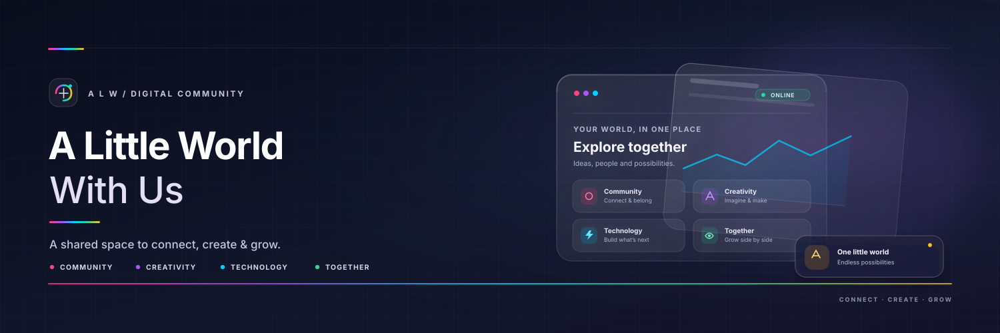

  

  
  
  
  
  
  

---

  <strong>A private platform for shared memories, real-time communication, wellness tracking, daily planning, and AI-powered experiences.</strong>

  memories · chat · wellness · planning · Korean learning

---

  
  &nbsp;
  

