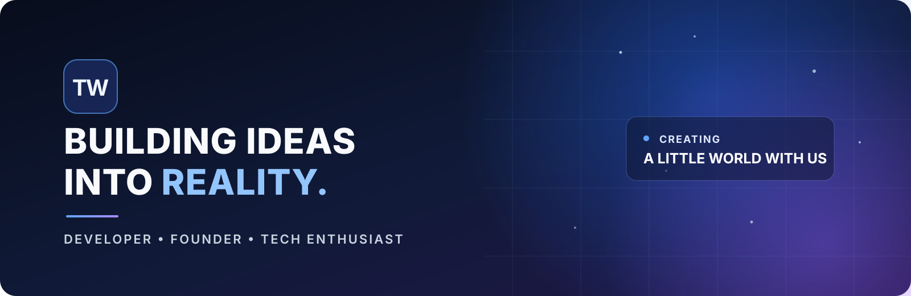

<h1 align="center">Hi, I'm Thu Won 👋</h1>
<h3 align="center">Founder & Developer · Building A Little World With Us</h3>

  <strong>Building ideas into reality.</strong> 
  I enjoy turning thoughtful ideas into useful digital experiences — from web and mobile products to connected services and automation.

  <a href="https://a-little-world-with-us.vercel.app">Live Project</a>
  ·
  <a href="https://github.com/alittleworldwithus/A-little-world-with-us">Main Repository</a>

---

## About

I'm building **A Little World With Us**, a shared digital space designed to bring everyday life, memories, wellness, and learning together.

The project is developed across web and mobile experiences, with a focus on practical features and thoughtful details.

### What I'm building

- **Vault & Memories** — shared memories and personal moments
- **Private Chat** — real-time conversations
- **Care & Daily Wellness** — everyday care and wellness tools
- **Shared Planning** — calendars, plans, and coordination
- **Korean Learning** — interactive learning experiences
- **AI Companion** — AI-assisted experiences
- **Telegram Integration** — bot-based project interaction

*Feature availability may vary while development and testing continue.*

## Technology

| Area | Technologies |
| --- | --- |
| Web | Next.js, React, TypeScript, Tailwind CSS |
| Mobile | Expo, React Native |
| Backend | Supabase, PostgreSQL, Auth, Realtime, Edge Functions |
| Cache & jobs | Upstash Redis, Supabase Cron |
| Media | Cloudinary, Backblaze B2 |
| Integrations | Google Drive, Telegram, email, push notifications, AI providers |

## Featured project

### A Little World With Us

A couples-focused platform concept for shared memories, communication, daily care, planning, and learning.

- **Website:** https://a-little-world-with-us.vercel.app
- **Source code:** https://github.com/alittleworldwithus/A-little-world-with-us

The main repository contains the web platform, mobile application, and supporting backend and integration code. For implementation details, setup instructions, and current project status, please visit the source repository.

## Connect

For project questions, feedback, or technical discussion, please open an issue in the [main repository](https://github.com/alittleworldwithus/A-little-world-with-us).

---

<i>Creating meaningful experiences, one idea at a time.</i>

